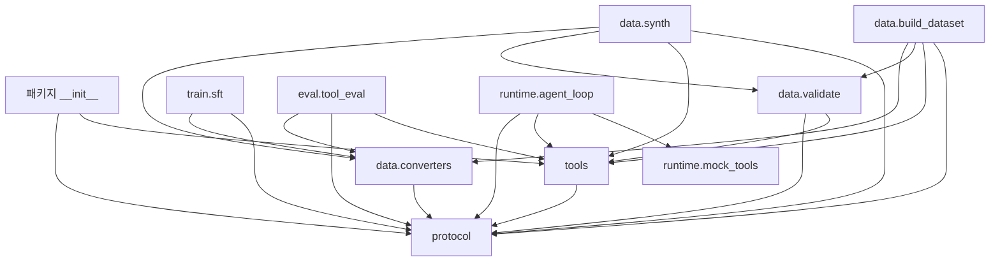

# FlowNote Agent — src 상세 코드맵

작성 기준: 2026-09-06, 현재 작업 디렉터리의 `src/` 코드. 커밋되지 않은 수정도 포함한 상태를 기준으로 한다. 모델 이름과 기본값은 코드에 지정된 값을 설명하며, 외부 서비스의 현재 사양을 검증한 문서는 아니다.

## 1. 전체 구조와 역할

이 프로젝트는 FlowNote 노트 관리 에이전트의 **학습 데이터 준비 → QLoRA 지도 미세조정(SFT) → 도구 호출 평가 → 도구 실행 루프**를 구현한 Python 패키지다. 중심은 `protocol.py`이며, 데이터 준비·학습·평가·런타임이 동일한 대화 자료형과 인코딩·파싱 규칙을 공유한다.

`src/`에는 Python 파일 **15개, 총 2,652줄**이 있다. 빈 하위 패키지 초기화 파일 4개를 포함하며, 줄 수에는 주석과 빈 줄도 포함한다.

```text
src/
└── flownote_agent/
    ├── __init__.py               21줄  패키지 공개 API
    ├── protocol.py              567줄  대화 자료형·인코더·파서·렌더러·학습 마스크
    ├── tools.py                  71줄  도구 명세 레지스트리와 인자 검증
    ├── data/
    │   ├── __init__.py            0줄  패키지 초기화 파일
    │   ├── converters.py        342줄  외부 데이터 형식 ↔ 내부 Sample
    │   ├── validate.py          133줄  대화 구조·도구 호출·왕복 변환 검증
    │   ├── synth.py             308줄  교사 모델 API를 통한 합성 데이터 생성
    │   └── build_dataset.py     224줄  소스 수집·언어 균형·학습/평가 분할
    ├── train/
    │   ├── __init__.py            0줄
    │   └── sft.py               335줄  데이터 토큰화·배치 구성·QLoRA 학습
    ├── eval/
    │   ├── __init__.py            0줄
    │   └── tool_eval.py         176줄  정답 이력 기반 도구 호출 평가
    └── runtime/
        ├── __init__.py            0줄
        ├── agent_loop.py        280줄  생성·파싱·검증·실행·재생성
        └── mock_tools.py        195줄  메모리 기반 도구 실행기 14개
```

### 모듈 의존 관계

아래 화살표는 왼쪽 모듈이 오른쪽 모듈을 사용한다는 뜻이다. `agent_loop → mock_tools`는 CLI의 `main()`에서 연결된다.



### src 밖에서 연결되는 파일

| 경로 | 연결 지점과 역할 |
| --- | --- |
| [`configs/tools/flownote_tools.json`](../configs/tools/flownote_tools.json) | `ToolRegistry.load()`의 기본 도구 명세. 14개 도구의 이름·설명·인자 JSON Schema |
| [`configs/data_mix.yaml`](../configs/data_mix.yaml) | `build_dataset.main()`의 소스 목록·수집 비중·언어 목표 비율 |
| [`configs/train_qlora.yaml`](../configs/train_qlora.yaml) | `sft.main()`의 모델·양자화·LoRA·데이터·학습 옵션 |
| `data/processed/synth.jsonl` | `synth`의 기본 출력이며 데이터 빌더의 입력 소스 |
| `data/processed/train.jsonl`, `eval.jsonl` | 데이터 빌더 출력. 학습기와 평가기 입력 |
| `outputs/flownote-e2b-qlora/final/` | 현재 학습 설정의 최종 어댑터·토크나이저 저장 위치 |
| [`Makefile`](../Makefile) | `PYTHONPATH=src:...`를 설정하고 각 모듈의 CLI 실행을 연결 |
| [`tests/`](../tests) | `test_protocol.py`, `test_masking.py`, `test_pipeline.py`에 관련 검증 코드 |

## 2. 공통 자료형과 데이터 흐름

### 내부 대화 표현

`Sample`은 대화 하나, `Message`는 대화의 한 단계, `ToolCall`은 도구 호출 하나다. 내부 `assistant` 메시지 여러 개와 중간 `tool` 메시지가 렌더링된 모델 대화에서는 하나의 `model` 턴으로 이어질 수 있다.

```text
Sample
├── id / source / lang          데이터 식별 및 분포 관리
├── system                      시스템 지시문
├── tools[]                     이 샘플에서 선언하는 도구 명세
└── messages[]
    ├── Message(role="user", content=...)
    ├── Message(role="assistant", thought=..., tool_calls=[ToolCall(...)])
    ├── Message(role="tool", name=..., result=...)
    └── Message(role="assistant", thought=..., content=...)
```

`thought`는 데이터에 저장된 모델의 계획 텍스트 필드이고, `content`는 사용자에게 보여 줄 본문이다. `tool_calls`는 실행 요청이며, `result`는 환경이 반환하는 값이다.

### 학습 데이터 흐름

```text
외부 HF 데이터 / 내부 JSONL / 교사 모델 응답
    → converters: Sample로 정규화
    → validate.check: 구조 및 호출 검증
    → build_dataset: 수집·언어 조정·분할
    → sample_to_row: train/eval JSONL 저장
    → AgentSFTDataset: from_internal → render → 토큰화 → build_loss_mask
    → Gemma4Collator: 패딩 + 배치 텐서
    → Trainer + LoRA → 어댑터 저장
```

### 런타임 흐름

```text
사용자 입력
    → AgentLoop.run
    → trim_history → Sample → render
    → LLM 생성 → parse_model_output
       ├── 도구 호출 없음 → content 반환
       └── 도구 호출 있음 → ToolRegistry.validate_call
            → executors[도구 이름](arguments)
            → Message(role="tool", result=...)
            → 같은 모델 턴의 다음 생성 단계
```

## 3. 패키지 진입점: __init__.py

파일: [`src/flownote_agent/__init__.py`](../src/flownote_agent/__init__.py)

직접 구현한 함수나 클래스는 없다. 다른 모듈의 핵심 API를 가져와 패키지 최상위에서 사용할 수 있게 한다.

| 변수 | 내용 |
| --- | --- |
| `__all__` | 외부에 공개하는 이름 13개를 나열하는 리스트 |

공개 이름은 `Message`, `ParsedTurn`, `Sample`, `ToolCall`, `build_loss_mask`, `format_tool_call`, `format_tool_response`, `parse_model_output`, `parse_model_turn`, `render`, `stop_token_ids`, `Tool`, `ToolRegistry`다. 자료형 4개 + 프로토콜 함수 7개 + 도구 클래스 2개로 구성된다.

`format_argument`, `parse_arguments`, `control_ids`, `ParseError` 등은 이 목록에 없으므로 해당 모듈에서 직접 가져온다.

## 4. protocol.py — 대화 프로토콜의 중심

파일: [`src/flownote_agent/protocol.py`](../src/flownote_agent/protocol.py)

파일 내부 순서는 **제어 토큰 → 대화 자료형 → 값 인코딩 → 값 파싱 → 모델 출력 파싱 → 채팅 템플릿 연결 → 학습 손실 마스킹**이다. 외부 모델 라이브러리를 직접 import하지 않고 전달받은 `tokenizer`의 메서드를 사용한다.

### 4.1 상수

| 이름 | 값 또는 역할 |
| --- | --- |
| `TURN_OPEN`, `TURN_CLOSE` | `<\|turn>`, `<turn\|>`: 대화 턴 시작·종료 |
| `TOOL_OPEN`, `TOOL_CLOSE` | `<\|tool>`, `<tool\|>`: 도구 선언 블록 |
| `CALL_OPEN`, `CALL_CLOSE` | `<\|tool_call>`, `<tool_call\|>`: 모델의 도구 호출 |
| `RESP_OPEN`, `RESP_CLOSE` | `<\|tool_response>`, `<tool_response\|>`: 환경 응답 구간 |
| `STR` | `<\|"\|>`: 일반 JSON 따옴표 대신 쓰는 문자열 구분자 |
| `THINK` | `<\|think\|>`: 생각 모드 제어 토큰 |
| `CHANNEL_OPEN`, `CHANNEL_CLOSE` | `<\|channel>`, `<channel\|>`: 생각 채널 경계 |
| `THOUGHT_HEADER` | `"thought"`: 채널 본문 앞에 붙는 이름 |
| `CONTROL_TOKENS` | 위 제어 토큰 12개를 모은 튜플. 토큰 ID 확인에 사용 |
| `DEFAULT_SYSTEM_KO` | 선언된 도구만 사용, 필수 인자 확인, 상대 시간 기준 조회, 삭제 확인, 결과에 없는 사실 금지 등의 기본 시스템 지시문 |

### 4.2 자료형

| 클래스 | 필드·기본값 | 역할 |
| --- | --- | --- |
| `ToolCall` | `name: str`, `arguments: dict[str, Any]` | 도구 이름과 입력 인자 |
| `Message` | `role`, `content=None`, `thought=None`, `tool_calls=[]`, `name=None`, `result=None` | 사용자·모델·도구 단계의 공통 표현. `role` 타입 표기는 `user/assistant/tool` |
| `Sample` | `messages`, `tools=[]`, `system=DEFAULT_SYSTEM_KO`, `lang="ko"`, `source="unknown"`, `id=None` | 학습·평가·렌더링의 대화 단위 |
| `ParsedTurn` | `thought=None`, `thoughts=[]`, `tool_calls=[]`, `content=None`, `errors=[]`, `stopped_for_tool=False` | 모델 출력 파싱 결과 |
| `ParseError` | `ValueError`의 하위 클래스 | 값 문법을 읽을 수 없을 때 사용하는 예외 |

리스트 필드의 `[]`는 설명용 표기다. 실제 코드는 `field(default_factory=list)`를 사용하므로 인스턴스 사이에 같은 리스트를 공유하지 않는다.

`ParsedTurn.wants_tool`은 `bool(tool_calls)`, `ParsedTurn.ok`는 `not errors`를 반환하는 속성이다. `thought`는 첫 생각 블록이고, `thoughts`는 발견한 모든 생각 블록이다.

### 4.3 인코딩 함수

| 함수 | 입력 → 출력 / 처리 |
| --- | --- |
| `format_argument(value, escape_keys=False)` | Python 값 → 모델 전용 값 문법. `None`, bool, 문자열, dict, list/tuple, 기타 값을 처리. dict 키를 정렬하고 재귀 변환. `escape_keys=True`이면 키도 `STR`로 감쌈 |
| `format_tool_call(call)` | `ToolCall` → 호출 시작·종료 토큰을 포함한 `call:name{...}` 문자열 |
| `format_tool_response(name, response)` | 환경 결과 → `response:name{...}`와 `RESP_CLOSE`. dict가 아닌 결과는 `value` 키로 감쌈. **`RESP_OPEN`은 포함하지 않음** |

예를 들어 `ToolCall("search_notes", {"query": "회의", "limit": 5})`는 다음과 같이 인코딩된다.

```text
<|tool_call>call:search_notes{limit:5,query:<|"|>회의<|"|>}<tool_call|>
```

`format_tool_response()`는 이미 모델이 응답 시작 토큰에서 멈췄다는 전제로 만든 보조 함수다. 현재 `AgentLoop`는 문자열을 직접 이어 붙이지 않고, 구조화된 메시지를 다시 `render()`한다.

### 4.4 _Scanner — 재귀 값 파서

상태 변수는 `self.s`(입력 문자열)와 `self.i`(현재 읽는 위치)다.

| 메서드 | 역할 |
| --- | --- |
| `__init__(text)` | 입력과 시작 위치 `0` 저장 |
| `skip_ws()` | 공백·탭·개행·캐리지 리턴 건너뛰기 |
| `at(literal)` | 현재 위치가 지정한 문자열로 시작하는지 확인 |
| `take(literal)` | 지정 문자열을 소비. 일치하지 않으면 `ParseError` |
| `value()` | 첫 구분자에 따라 문자열·객체·배열·리터럴 파서로 분기 |
| `mapping()` | `{key:value,...}` → dict. 키는 일반 문자열 또는 `STR`로 감싼 문자열 |
| `array()` | `[value,...]` → list. 각 요소는 `value()`로 재귀 처리 |
| `literal()` | `true/false/null/None/빈 값`, int, float 순서로 해석하고 나머지는 문자열로 반환 |

`parse_arguments(text)`는 `_Scanner.mapping()`을 호출해 dict를 반환한다. 객체를 읽은 뒤 남은 문자열까지 모두 소비했는지는 검사하지 않는다. 또한 `literal()`은 구분자가 없는 문자열도 허용하므로 엄격한 JSON 파서와 동작이 다르다.

### 4.5 모델 출력 파싱 함수

| 함수 | 역할 |
| --- | --- |
| `_blocks(text, open_tag, close_tag)` | 태그 사이 본문 리스트와 닫히지 않은 블록 여부를 반환 |
| `_strip_blocks(text, pairs)` | 지정된 블록을 제거해 사용자용 본문을 추출할 준비 |
| `_parse(text, strict)` | 모델 헤더 제거, 턴 종료 지점 자르기, 생각·호출·본문 추출, 오류 수집 |
| `parse_model_output(text)` | `strict=True`. 한 번의 생성 단계용. 여러 생각 블록이나 도구 호출과 일반 본문의 혼합을 오류로 기록 |
| `parse_model_turn(text)` | `strict=False`. 여러 도구 왕복과 마지막 답변이 포함된 전체 모델 턴 검증용 |

`_parse()`의 주요 지역 변수는 `turn`(결과 객체), `cut`(턴 종료 절단 위치), `thoughts`/`calls`(블록 본문), `prose`(제어 블록을 제거한 일반 텍스트)다. 입력 끝이 `RESP_OPEN`이면 `stopped_for_tool=True`를 기록한다. 오류를 `errors`에 남기는 것이 기본 계약이므로 호출자는 `ok`와 `tool_calls`를 별도로 확인할 수 있다.

### 4.6 채팅 템플릿 연결

| 함수 | 역할 |
| --- | --- |
| `to_chat_tools(tools)` | 평탄한 도구 명세를 `{"type":"function","function":spec}` 구조로 포장. 이미 포장된 명세는 유지 |
| `to_chat_messages(sample)` | `Sample` → 템플릿 입력 메시지 목록. `thought`를 `reasoning`으로 변환하고 호출마다 `call_0` 등의 ID 부여 |
| `render(sample, tokenizer, add_generation_prompt=False, enable_thinking=True)` | `tokenizer.apply_chat_template()` 호출. `tokenize=False`, `preserve_thinking=True`로 문자열 반환 |

`to_chat_messages()`는 `tool` 메시지를 독립 메시지로 출력하지 않는다. 뒤에서부터 찾아 가장 최근의 도구 호출 assistant 메시지에 `tool_responses`로 붙인다. 앞선 호출이 없으면 `ValueError`를 발생시킨다.

렌더링 결과를 다시 토큰화할 때는 호출부에서 `add_special_tokens=False`를 사용한다. 템플릿이 이미 추가한 특수 토큰을 중복해서 넣지 않기 위한 처리다.

### 4.7 제어 ID와 학습 마스크

| 함수 | 역할 |
| --- | --- |
| `control_ids(tokenizer)` | `CONTROL_TOKENS` 각각을 토큰 ID로 변환. `None` 또는 unknown ID이면 `ValueError` |
| `stop_token_ids(tokenizer)` | `TURN_CLOSE`, `RESP_OPEN`, 그리고 중복되지 않는 EOS ID 목록 반환 |
| `build_loss_mask(input_ids, tokenizer, supervise_role="model")` | 학습할 토큰 위치에는 원래 토큰 ID, 제외할 위치에는 `-100`을 넣은 labels 리스트 반환 |

`control_ids()`는 토크나이저에 이미 있는 ID를 확인하며 새 토큰을 등록하지 않는다. 실제 문자열을 `encode()`해서 길이가 1인지 실측하는 함수는 아니다.

`build_loss_mask()`의 주요 변수:

| 변수 | 역할 |
| --- | --- |
| `labels` | 입력 길이만큼 `-100`으로 시작하는 학습 대상 배열 |
| `in_target_turn` | 현재 턴의 역할이 `supervise_role`인지 여부 |
| `in_response_payload` | 환경이 쓴 도구 응답 본문 구간인지 여부 |
| `i`, `j`, `role`, `piece` | 토큰 위치와 턴 헤더를 개행까지 해석하기 위한 임시 상태 |
| `turn_open`, `turn_close`, `resp_open`, `resp_close` | 상태 전환에 사용하는 토큰 ID |

| 구간 | labels 처리 |
| --- | --- |
| 시스템·사용자 본문, 턴 시작 헤더 | `-100` |
| 모델의 생각·도구 호출·최종 답변 | 원래 토큰 ID |
| `RESP_OPEN` | 원래 토큰 ID. 도구에 제어를 넘기는 정지 신호를 학습 |
| 환경 응답 본문과 `RESP_CLOSE` | `-100` |
| 모델 턴의 `TURN_CLOSE` | 원래 토큰 ID. 최종 종료 신호를 학습 |

## 5. tools.py — 도구 명세와 스키마 검증

파일: [`src/flownote_agent/tools.py`](../src/flownote_agent/tools.py)

`DEFAULT_TOOLS_PATH`는 파일 위치에서 저장소 루트로 올라가 `configs/tools/flownote_tools.json`을 가리키는 `Path`다. 따라서 기본 로드는 저장소의 현재 디렉터리 배치에 의존한다.

| 클래스 / 변수 | 역할 |
| --- | --- |
| `Tool` | `name`, `description`, `parameters` 필드를 가진 dataclass |
| `ToolRegistry._tools` | 도구 이름 → `Tool` 객체 dict |
| `ToolRegistry._validators` | 도구 이름 → `Draft202012Validator` 객체 dict |

| 메서드 | 입력·출력과 동작 |
| --- | --- |
| `Tool.spec()` | 세 필드를 평탄한 명세 dict로 반환 |
| `ToolRegistry.__init__(tools)` | 이름별 도구와 validator를 구성. 같은 이름이 중복되면 dict의 마지막 값이 남음 |
| `ToolRegistry.load(path=DEFAULT_TOOLS_PATH)` | JSON 배열을 읽고 `Tool(**entry)`로 레지스트리 생성하는 classmethod |
| `ToolRegistry.__contains__(name)` | `name in registry` 지원 |
| `ToolRegistry.__len__()` | 등록 도구 수 반환 |
| `ToolRegistry.names` | 등록된 도구 이름 리스트를 반환하는 property |
| `ToolRegistry.specs(subset=None)` | 전체 또는 지정 이름의 명세 리스트. 등록되지 않은 이름은 생략 |
| `ToolRegistry.validate_call(call)` | 알 수 없는 도구 또는 인자 스키마 오류를 문자열 리스트로 반환. 빈 리스트는 검증 통과 |

검증 오류는 `도구명.필드경로: 원인` 형태다. 이 모듈은 **도구 명세와 인자 검증**을 맡으며, 실제 도구 실행 함수는 `AgentLoop.executors`에 별도로 연결된다.

## 6. data/converters.py — 데이터 형식 정규화

파일: [`src/flownote_agent/data/converters.py`](../src/flownote_agent/data/converters.py)

대부분의 변환 함수는 외부 row dict를 받아 `Sample` 또는 거절을 뜻하는 `None`을 반환한다. 모든 잘못된 입력을 자체적으로 예외 없이 처리하는 것은 아니며, 빌더의 `collect_source()`가 변환 예외를 추가로 처리한다.

### 상수와 등록 테이블

| 이름 | 역할 |
| --- | --- |
| `GENERAL_SYSTEM_KO` | 일반 질의응답용 기본 시스템 문구 |
| `CODE_SYSTEM` | 실행 가능한 코드와 짧은 설명을 요구하는 코딩 시스템 문구 |
| `_HANGUL` | 한글 음절 `[가-힣]` 탐지 정규식 |
| `_LATIN_WORD` | 2자 이상 영문 단어 `[A-Za-z]{2,}` 탐지 정규식 |
| `_GLAIVE_SPLIT` | Glaive의 `USER:`, `ASSISTANT:`, `FUNCTION RESPONSE:` 구분 정규식 |
| `CONVERTERS` | `xlam/glaive/sharegpt/alpaca/magicoder/passthrough` → 각 변환 함수 매핑 |

### 함수 목록

| 함수 | 입력 → 출력 / 핵심 동작 |
| --- | --- |
| `detect_lang(text)` | 문자열 → `ko/en/mixed`. 한글 음절 수 `ko`와 영문 단어 수 `en`을 비교. 둘 다 있고 `0.2 < ko/(ko+en) < 0.85`이면 `mixed` |
| `_loads_maybe(value)` | 문자열에 중첩된 JSON을 최대 두 번 디코딩. 디코딩 실패 시 해당 값을 그대로 반환 |
| `_normalize_tool_spec(spec)` | `function` 포장을 풀고 `name/description/parameters`로 통일. `input_schema`도 허용. 타입 없는 파라미터 맵은 object schema로 포장하고 required 추정 |
| `from_xlam(row)` | `query/tools/answers`를 단일 사용자 요청과 assistant 호출 메시지로 변환. 여러 호출을 유지하고 도구 이름을 넣은 짧은 `thought` 생성 |
| `from_glaive(row)` | 평문 transcript의 역할 마커와 `<functioncall>`을 파싱. `pending_call_name`으로 도구 응답 이름 연결. 도구 호출이 없거나 마지막이 assistant가 아니면 거절 |
| `from_sharegpt(row)` | `conversations[{from,value}]` 변환. `human/user → user`, `gpt/assistant → assistant`, system 발화는 시스템 지시문으로 분리 |
| `from_alpaca(row)` | `instruction`과 선택적 `input`을 사용자 본문으로 합치고 `output`을 답변으로 변환 |
| `from_magicoder(row)` | `problem/solution` → 사용자/assistant 메시지. `CODE_SYSTEM`, `lang="en"` 사용 |
| `from_internal(row)` | 내부 JSONL dict → `Sample`. `messages`와 역할을 확인하고 호출을 `ToolCall`로 복원. 생략된 메타데이터 기본값 보충 |
| `sample_to_row(sample)` | `Sample` → JSON으로 저장 가능한 내부 dict. 의미 있는 메시지 필드만 포함 |

`_normalize_tool_spec()`은 설명을 400자로 제한한다. 파라미터 맵에서 `optional`이 참이 아니고 `default`가 `None`인 항목을 필수 인자로 추정한다.

`detect_lang()`은 실제 언어 식별 모델이 아니다. 한글은 글자 수, 영문은 단어 수로 세므로 `lang`은 데이터 분포 조정용 근삿값으로 이해해야 한다.

## 7. data/validate.py — 데이터 수락 조건

파일: [`src/flownote_agent/data/validate.py`](../src/flownote_agent/data/validate.py)

### Report

| 구성 요소 | 역할 |
| --- | --- |
| `kept: int = 0` | 수락한 샘플 수 |
| `rejected: Counter` | 거절 사유별 횟수 |
| `reject(reason)` | 해당 거절 사유 카운트 증가 |
| `total` | `kept + 모든 거절 횟수`를 반환하는 property |
| `render()` | 수락 수와 빈도순 거절 원인을 여러 줄 문자열로 반환 |

### check(sample, registry=None, strict_tools=False, tokenizer=None)

결과는 문제 문자열 리스트이며, `[]`이면 현재 검사 항목을 통과한 것이다.

1. 메시지가 있는지, 첫 메시지가 user이고 마지막이 assistant인지 확인한다.
2. assistant가 비어 있거나 호출과 본문을 섞거나 연속으로 등장하는지 확인한다.
3. `prev`와 `open_calls`로 도구 응답의 앞선 역할, 이름 누락, 호출보다 많은 응답을 확인한다.
4. 레지스트리가 있으면 도구 검사를 수행한다. `strict_tools=True`이면 등록된 FlowNote 스키마로 검증하고, 거짓이면 명세가 존재할 때 선언되지 않은 호출 이름을 검사한다.
5. 각 호출을 `format_tool_call()`로 쓰고 `parse_model_output()`으로 다시 읽어 이름과 인자가 유지되는지 확인한다.
6. `tokenizer`까지 전달되면 전체 `render()` 결과를 `parse_model_turn()`으로 다시 읽고 호출 목록이 보존되는지 비교한다.

주요 지역 변수는 `problems`, `msgs`, `prev`, `open_calls`, `declared`, `expected_calls`, `got_calls`다.

검사 범위를 이해할 때 다음 차이가 중요하다. strict 검증은 전역 레지스트리의 존재·스키마를 확인하지만 **샘플의 도구 subset에 포함됐는지를 별도로 확인하지 않는다**. 또한 응답 이름과 호출 이름의 일치, 남아 있는 미응답 호출 수가 0인지 여부, 모든 assistant의 `thought` 필수 여부는 검사하지 않는다. 호출 직후 끝나는 xLAM 같은 샘플도 표현할 수 있다.

## 8. data/synth.py — 교사 모델 기반 합성 데이터

파일: [`src/flownote_agent/data/synth.py`](../src/flownote_agent/data/synth.py)

도구 명세·시나리오·언어를 포함한 프롬프트를 만들어 교사 API를 호출하고, 검증을 통과한 대화를 JSONL로 저장한다.

### 설정 상수

| 이름 | 값 / 역할 |
| --- | --- |
| `TEACHER_MODEL` | 코드 기본값 `"claude-opus-5"` |
| `SCENARIOS` | 시나리오 이름·가중치·설명을 가진 튜플 리스트 |
| `LANG_MIX` | `ko=0.50`, `en=0.30`, `mixed=0.20` |
| `PROMPT` | 도구 명세, 시나리오, 언어, JSON 출력 형식, 대화 규칙과 다양성 지시를 삽입하는 템플릿 |

| 시나리오 | 가중치 | 생성 의도 |
| --- | --- | --- |
| `single_call` | 0.22 | 도구 한 번 호출 후 결과 요약 |
| `multi_step` | 0.22 | 앞 결과를 다음 인자로 사용하는 순차 호출 |
| `parallel_call` | 0.10 | 같은 단계에서 독립적인 호출 여러 개 출력 |
| `error_recovery` | 0.16 | 도구 오류나 빈 결과 이후 수정·재시도 |
| `clarify` | 0.12 | 인자가 부족하면 호출 없이 되묻기 |
| `no_tool` | 0.10 | 도구가 필요 없는 요청에 답변 |
| `refuse_confirm` | 0.08 | 삭제 같은 작업을 실행하기 전에 확인 요청 |

### 함수 목록

| 함수 | 역할 |
| --- | --- |
| `pick(options, rng)` | 난수 `r`와 누적 가중치 `acc`로 `(이름, 설명)` 선택. 마지막 항목을 fallback으로 사용 |
| `build_prompt(registry, rng)` | 도구 4~8개를 무작위 선택하고 시나리오·언어를 뽑음. 삭제 확인 시나리오에서는 `delete_note` 포함을 강제. `(prompt, scenario_name, lang, subset)` 반환 |
| `strip_fence(text)` | 응답 앞뒤 공백과 Markdown 코드 펜스 제거 |
| `generate_one(client, registry, rng, index, model=TEACHER_MODEL, effort="medium")` | API 호출 → 종료 사유 검사 → JSON 해석 → 내부 행 구성 → `from_internal`/`check` 검증 → 시나리오별 호출 존재 검사. `(row 또는 None, 상태 문자열)` 반환 |
| `main()` | CLI 해석, API 키 확인, 스레드 풀로 생성 작업 제출, JSONL 저장과 수락·거절 통계 출력 |

`generate_one()`의 API 인자는 `max_tokens=4096`, `output_config={"effort": effort}`다. text 타입 응답 블록만 이어 붙이며, API 예외·거절 응답·토큰 상한 종료·JSON 파싱 실패 등을 실패 상태로 반환한다. JSON 최상위 값이 객체인지 등 모든 예외 상황을 감싸는 구조는 아니다.

주요 실행 변수:

| 변수 | 역할 |
| --- | --- |
| `client` | `Anthropic()` 클라이언트 |
| `rng`, `seeds` | 선택 재현성과 작업별 난수 생성기 |
| `stats` | 상태 문자열별 결과 카운터 |
| `written`, `attempts` | 저장한 행 수와 제출한 생성 작업 수 |
| `max_attempts` | `args.n * 3`으로 정한 루프 진입 기준 |
| `batch`, `futures` | 한 번에 제출하는 생성 작업 수와 Future 목록 |
| `out_path` | 출력 JSONL 경로. `"w"` 모드로 새로 기록 |

CLI 기본값은 `--n 500`, `--workers 8`, `--seed 0`, `--effort medium`, `--out data/processed/synth.jsonl`이다. `--model`, `--tools`, `--dry-run`을 지원하며, dry-run은 프롬프트 출력 후 API 호출 없이 종료한다. 실제 생성에는 `ANTHROPIC_API_KEY`가 필요하다.

현재 구현에서 확인한 의도와 동작의 차이:

- `refuse_confirm` 프롬프트는 실행 전 확인을 요구하지만, 후속 검사에서는 `clarify/no_tool` 외의 모든 시나리오에 도구 호출이 있어야 한다고 요구한다. 확인 질문만 있는 올바른 형태도 거절될 수 있다.
- `build_prompt()`는 `get_current_time`을 항상 포함시키지 않으며, 레지스트리 도구 수가 4개 미만인 입력도 처리하지 않는다.
- `max_attempts`는 배치 제출 전에만 검사하므로 마지막 배치로 `n * 3`을 넘을 수 있다.
- `multi_step`, `parallel_call`, `error_recovery`의 구조를 각각 정밀하게 검사하지는 않는다. 후속 검사는 주로 호출 존재 여부다.

## 9. data/build_dataset.py — 수집·혼합·분할

파일: [`src/flownote_agent/data/build_dataset.py`](../src/flownote_agent/data/build_dataset.py)

### 함수와 상수

| 이름 | 역할 |
| --- | --- |
| `iter_hf(repo, split, limit)` | `datasets.load_dataset(..., streaming=True)`으로 원본 행을 제한 수까지 순회하는 generator |
| `iter_local(path, limit)` | 로컬 JSONL 순회. 없는 파일이면 아무 행도 반환하지 않음. 제한은 빈 줄을 포함한 원본 줄 인덱스 기준 |
| `collect_source(spec, target, registry, oversample=3.0)` | 소스별 변환기 선택 → 순회 → 변환 → 검증 → 수락 목록과 `Report` 반환 |
| `MIN_BALANCE_RETENTION` | `0.5`. 언어 조정으로 너무 많은 샘플을 잃는 것을 막는 기준 |
| `enforce_language_targets(samples, targets, rng)` | 언어별 버킷을 만들고 부족한 언어에 맞춰 많은 언어를 줄임. 원본의 절반 미만만 남는 계산이면 조정을 생략 |
| `main()` | 설정 로드, 소스별 수집, 언어 조정, 셔플, train/eval JSONL 저장과 분포 출력 |

`collect_source()`의 핵심 변수는 `convert`(변환 함수), `strict`(`passthrough` 여부), `budget=int(target*oversample)+100`(읽기 상한), `kept`, `report`다. 수락한 샘플의 `source`는 설정의 `spec["name"]`으로 덮어쓴다.

`enforce_language_targets()`의 핵심 변수:

| 변수 | 역할 |
| --- | --- |
| `buckets` | 언어 → 해당 샘플 리스트 |
| `shares` | 양수인 목표 비율만 남긴 dict |
| `caps` | 언어별 `보유량 / 목표 비율`로 계산한 전체 수용량 |
| `bottleneck` | 전체 수용량이 가장 작은 언어 |
| `total` | 병목 언어가 허용하는 목표 전체 수 |
| `untargeted` | 목표 설정에 등장하지 않은 언어의 샘플. 결과에 별도로 유지 |
| `out` | 언어별 필요 수만 남긴 결과 리스트 |

부족한 데이터를 복제하지 않는다. 설정의 목표 비율은 합계가 적절한 양수 값이라는 전제를 두며, 비율 정규화나 모든 값이 0인 경우의 방어는 없다.

### main()의 처리 순서

1. `total_examples`와 `sources`를 읽고 각 소스의 목표를 `int(total * weight)`로 계산한다.
2. `--only`가 있으면 지정한 소스만 수집한다. 다른 소스의 가중치를 다시 정규화하지 않는다.
3. 소스 처리 실패는 메시지를 출력하고 해당 소스를 건너뛴다. 전체 수집 결과가 없으면 종료한다.
4. 언어 균형을 조정한 뒤 난수로 셔플한다.
5. `eval_n = min(eval_size, max(1, len(all_samples)//10))`으로 평가 데이터 수를 정한다.
6. 앞부분은 eval, 나머지는 train으로 저장하고 언어·소스·도구 호출 비율을 출력한다.

주요 변수는 `cfg`, `registry`, `rng`, `all_samples`, `before/after` 언어 카운터, `eval_set/train_set`, `agentic`(호출 포함 학습 샘플 수)다.

CLI는 `--config configs/data_mix.yaml`, `--tools`, `--out-dir data/processed`, `--eval-size 500`, `--seed 42`, `--only [소스명 ...]`을 받는다. 수집 비중은 목표이며, 소스 부족·실패·검증 거절·언어 조정 때문에 실제 결과 비중과 전체 수는 달라질 수 있다. 중복 제거 또는 대화 그룹을 고려한 train/eval 분리는 구현되어 있지 않다.

## 10. train/sft.py — QLoRA 학습

파일: [`src/flownote_agent/train/sft.py`](../src/flownote_agent/train/sft.py)

`transformers.Trainer`와 직접 만든 토큰 labels를 사용한다. 주요 외부 의존성은 `torch`, `yaml`, `transformers`, `peft`이며, 4비트 모델 로딩은 `BitsAndBytesConfig`를 통해 설정한다.

### 10.1 AgentSFTDataset(Dataset)

| 구성 요소 | 역할 |
| --- | --- |
| `examples` | 미리 토큰화한 `{"input_ids": [...], "labels": [...]}` 목록 |
| `stats` | `total`, `overlong`, `no_target`, `unparseable`, `render_failed` 카운터 |
| `__init__(path, tokenizer, max_seq_len, drop_overlong=True, train_on_model_turns_only=True)` | JSONL 로드부터 렌더링·토큰화·길이 처리·마스크 생성까지 수행 |
| `__len__()` | 사용 가능한 예제 수 |
| `__getitem__(idx)` | 해당 예제 dict |

생성자는 `control_ids()`를 먼저 실행한다. `from_internal()`이 `None`이면 제외하고, `render()` 예외도 해당 행 제외로 처리한다. 길이를 넘으면 기본적으로 행 전체를 버리며, `drop_overlong=False`이면 토큰을 앞에서 자른다.

`train_on_model_turns_only=True`이면 `build_loss_mask()`를 적용한다. 거짓이면 입력 토큰 전체가 labels가 된다. 감독할 토큰이 없으면 제외하고, 최종 예제가 0개면 `SystemExit`한다. JSON 문법 오류 자체를 잡는 try/except는 없으며, 여기서 `validate.check()`를 다시 실행하지는 않는다.

### 10.2 Gemma4Collator

`pad_token_id` 필드를 가진 dataclass다. `__call__(features)`는 배치 내 최대 길이 `width`를 구한 뒤 오른쪽 패딩을 적용해 `torch.long` 텐서 dict를 만든다.

| 출력 키 | 실제 토큰 위치 | 패딩 위치 |
| --- | --- | --- |
| `input_ids` | 원래 토큰 ID | `pad_token_id` |
| `labels` | 기존 학습 labels | `-100` |
| `attention_mask` | 1 | 0 |
| `token_type_ids` | 0 | 0 |
| `mm_token_type_ids` | 0 | 0 |

두 token type 배열은 텍스트 배치이므로 모두 0으로 구성된다. `Trainer`에는 `remove_unused_columns=False`를 지정해 추가 입력 키가 제거되지 않도록 한다.

### 10.3 모델 구성 함수

| 함수 | 역할 |
| --- | --- |
| `load_base_model(cfg)` | `cfg["model"]`, `cfg["quantization"]`에서 dtype·NF4·이중 양자화 옵션을 읽어 `AutoModelForImageTextToText` 로드. CUDA가 있으면 GPU 0, 아니면 CPU 지정 |
| `resolve_lora_targets(model, suffixes, scope_contains)` | `named_modules()`를 순회해 클래스 이름이 `Linear/Linear4bit/Linear8bitLt`이고 접미사·범위 조건에 맞는 모듈의 전체 이름 반환 |
| `main()` | 데이터 구성, dry-run, 양자화 학습 준비, LoRA 부착, Trainer 실행, 최종 저장 |

`resolve_lora_targets()`의 `linear_types`, `matched`, `skipped`, `buckets`는 각각 허용 클래스명, 선택된 모듈, 범위 조건으로 제외한 모듈, 접미사별 개수를 저장한다. 선택 결과가 없으면 종료한다. 클래스명 필터가 먼저 적용되므로 `skipped`가 모델의 모든 제외 모듈을 뜻하지는 않는다.

### 10.4 main() 내부 구성

| 변수 / 단계 | 역할 |
| --- | --- |
| `cfg`, `dcfg`, `tcfg`, `lcfg` | 전체 및 `data/train/lora` 설정 |
| `tok` | 기본 모델의 토크나이저. pad가 없으면 eos 사용 |
| `train_ds`, `eval_ds` | 전처리된 학습/평가 데이터. eval 파일이 존재할 때만 eval 구성 |
| `lengths`, `supervised` | 길이 분위수와 감독 토큰 비율 출력용 |
| `keep`, `drop` | dry-run에서 감독/마스킹 토큰을 따로 디코딩하기 위한 목록 |
| `model.config.use_cache` | `train.use_cache` 설정 적용. 4비트 학습 준비 이후에도 다시 적용 |
| `targets` | 실제 모듈 전체 이름으로 구한 LoRA 대상 |
| `trainer` | 배치·옵티마이저·체크포인트·평가 정책을 묶은 `Trainer` |
| `out_dir` | 토크나이저와 체크포인트, `final/` 어댑터 저장 경로 |

4비트 설정이면 `prepare_model_for_kbit_training()`을 호출한다. 이후 `LoraConfig`의 `r/alpha/dropout/bias/target_modules/modules_to_save`를 구성하고 `task_type="CAUSAL_LM"`으로 어댑터를 붙인다. gradient checkpointing에는 `use_reentrant=False`를 전달한다.

CLI는 `--config configs/train_qlora.yaml`, `--resume <체크포인트>`, `--dry-run`이다. dry-run은 데이터셋과 마스킹 결과를 출력하고 모델 로드·학습 전에 끝난다. `train.max_steps`는 기본 -1로 epoch 기준을 사용하며 양수이면 학습 스텝 상한을 지정한다. `train.per_device_eval_batch_size`는 기본 1이다. 작은 GPU 실험 구성과 실행 스크립트는 [학습 환경 가이드](TRAINING.md)에 정리되어 있다.

현재 설정 파일 기준 주요 값은 기본 모델 `google/gemma-4-E2B-it`, 4비트 NF4, LoRA `r=32/alpha=64/dropout=0.05`, scope `language_model`, 최대 길이 4096, 3 epoch, 배치 1, gradient accumulation 16이다. 이는 코드와 설정의 기본 실행값이며 실제 성능·메모리 사용량을 측정한 결과는 아니다.

## 11. eval/tool_eval.py — 도구 호출 평가

파일: [`src/flownote_agent/eval/tool_eval.py`](../src/flownote_agent/eval/tool_eval.py)

정답 대화에서 assistant가 답할 각 위치까지의 **정답 이력**을 입력하고 한 단계만 생성한다. 이전 단계의 모델 오답을 다음 단계로 누적하는 전체 에이전트 실행 평가는 아니다.

| 함수 | 역할 |
| --- | --- |
| `steps(sample, tokenizer)` | assistant 메시지마다 앞선 메시지만 담은 `prefix: Sample`을 만들어 `(생성 프롬프트, 원본 assistant 인덱스)` 목록 반환 |
| `main()` | 모델·선택적 어댑터 로드, 단계별 생성·파싱, 정답 호출 비교, 통계 출력, 선택적 JSONL 덤프 |

주요 변수:

| 변수 | 역할 |
| --- | --- |
| `registry`, `tok`, `model`, `quant` | 스키마 검사와 모델 생성 준비 |
| `stops` | 턴 종료·도구 응답 시작·EOS 정지 ID |
| `sampling` | 기본 `temperature=1.0/top_p=0.95/top_k=64`; `--greedy`면 `do_sample=False` |
| `m: Counter` | 단계 및 호출별 지표 누계 |
| `ref`, `pred` | 정답 assistant 메시지와 파싱된 예측 |
| `want`, `got` | `(도구 이름, 인자 dict)` 목록. 순서도 비교 대상 |
| `declared` | 해당 샘플에 선언된 도구 이름 집합 |
| `rows` | `--dump`가 있을 때 저장할 단계별 상세 결과 |
| `total`, `calls`, `want_steps`, `verifiable` | 출력 비율의 분모. 0으로 나누지 않도록 최소 1 적용 |

### 집계 지표

| 카운터 / 출력 | 의미와 분모 |
| --- | --- |
| `steps` | 평가한 assistant 단계 수 |
| `format_ok / steps` | `pred.ok`인 단계 비율 |
| `has_thought / steps` | 비어 있지 않은 첫 생각 블록이 있는 비율 |
| `name_exact / want_call_steps` | 호출이 필요한 단계 중 도구 이름 목록과 순서가 정확한 비율 |
| `args_exact / want_call_steps` | 호출이 필요한 단계 중 이름·인자·순서가 모두 정확한 비율 |
| `schema_ok / (schema_ok + schema_bad)` | 로컬 레지스트리로 검증 가능한 호출 중 통과한 비율 |
| `hallucinated_tool / calls` | 샘플에 선언되지 않은 도구 호출 비율 |
| `missed_call / steps` | 호출이 필요한데 호출하지 않은 단계 비율 |
| `over_call / steps` | 호출이 필요 없는데 호출한 단계 비율 |
| `correct_abstain` | 호출이 필요 없고 실제 호출도 없는 단계 수. 누적하지만 별도 출력하지 않음 |
| `schema_unverifiable` | 샘플에는 선언됐지만 로컬 레지스트리에 없어 스키마 검증하지 않은 호출 수 |

공개 데이터의 자체 스키마를 validator로 생성해 검사하지는 않는다. schema-valid 비율의 분모는 모든 호출이 아닌 **로컬에서 검증한 호출**이다. 검증 가능한 호출이 0개면 분모 보호 값 1이 출력 설명에도 사용된다.

CLI는 `--base`, `--adapter`, `--data`, `--tools`, `--limit 200`, `--max-new-tokens 512`, `--greedy`, `--no-4bit`, `--dump`다. `--limit`은 평가 단계 수가 아니라 입력의 비어 있지 않은 JSONL 행 수 제한이다. 덤프 행은 `id/step/lang/expected/got/errors/raw`를 포함한다.

## 12. runtime/agent_loop.py — 실행 제어

파일: [`src/flownote_agent/runtime/agent_loop.py`](../src/flownote_agent/runtime/agent_loop.py)

### 12.1 호출 인터페이스와 예산

| 이름 | 정의 / 역할 |
| --- | --- |
| `LLM(Protocol)` | `__call__(prompt: str, max_new_tokens: int=512) -> str`를 요구하는 호출 인터페이스 |
| `ToolFn` | `Callable[[dict[str, Any]], Any]`. 인자 dict를 받아 결과를 반환하는 실행기 타입 |
| `Budget.total` | 기본 8192 |
| `Budget.generation` | 기본 1024. 매 생성 단계의 새 토큰 상한 |
| `Budget.system_reserve` | 기본 2048. 시스템·도구 선언 등에 예약하는 계산상 여유 |
| `Budget.history` | `max(512, total - generation - system_reserve)`. 기본 5120 |

### 12.2 AgentLoop 필드

| 필드 | 역할 / 기본값 |
| --- | --- |
| `llm` | 실제 텍스트 생성 호출자 |
| `registry` | 도구 명세와 인자 검증 레지스트리 |
| `executors` | 도구 이름 → 실행 함수 dict, 기본 빈 dict |
| `tokenizer` | 템플릿 렌더링·토큰 수 계산, 기본 `None` |
| `system` | `DEFAULT_SYSTEM_KO` |
| `max_steps` | 최대 생성 단계 6 |
| `budget` | 새 `Budget()` |
| `verbose` | 로그 출력 여부, 기본 `True` |

### 12.3 AgentLoop 메서드

| 메서드 | 역할 |
| --- | --- |
| `_log(label, body)` | verbose일 때 라벨을 강조해 로그 출력 |
| `_tokens(text)` | 토크나이저로 길이 계산. 없으면 `len(text)//2`로 추정 |
| `_render(messages, specs)` | `Sample`을 만들고 생성 프롬프트를 렌더링. tokenizer가 없으면 `RuntimeError` |
| `_rounds(messages)` | assistant와 뒤따르는 tool 응답을 같은 블록으로 묶기 위한 staticmethod |
| `_weight(messages)` | content·thought·호출 인자·도구 결과를 합친 문자열의 토큰 수 추정 |
| `trim_history(messages)` | 첫 블록과 최신 블록을 남기고 중간의 큰 도구 결과를 축약한 다음, 필요하면 오래된 블록 삭제 |
| `execute(call)` | 스키마 검사 → 실행기 조회 → 호출. 오류도 도구 결과 dict로 반환 |
| `run(user_text, tool_subset=None)` | 사용자 메시지에서 시작해 생성·파싱·호출·응답 누적을 반복하고 최종 문자열 반환 |

`trim_history()` 내부의 중첩 함수 `flatten(bs)`는 블록을 메시지 목록으로 펴고, `fits()`는 현재 `head + middle + tail`의 무게가 history 예산 이내인지 확인한다. `head/tail`은 유지할 첫/마지막 블록, `middle`은 축약·삭제 가능한 블록들이다.

도구 결과 JSON 문자열이 160자를 넘으면 `{"elided": "N chars", "head": 앞 120자}`로 바꾼다. 이때 원래 `Message.result`를 직접 변경한다. 첫 블록과 마지막 블록은 유지하므로 예산 충족을 항상 보장하지 않으며, `_weight()`도 전체 렌더링 프롬프트의 정확한 길이는 아니다.

`execute()` 반환 정책:

| 상황 | 결과 |
| --- | --- |
| 도구 이름·인자 검증 실패 | `{"error":"invalid_arguments","details":...}` |
| 실행기 미등록 | `{"error":"not_implemented","details":...}` |
| 실행 중 예외 | 예외 클래스 이름을 `error`로, 메시지 앞 300자를 `details`로 반환 |
| 정상 실행 | 실행 함수의 반환값을 그대로 사용 |

`run()`은 `messages`, `specs`, `step`, `raw`, `turn`, `answer`, `result`를 지역 상태로 사용한다. 파싱 오류는 로그에 남기고, 파싱된 호출이 있다면 실행을 진행한다. 도구 호출이 없으면 `turn.content` 또는 `"(빈 응답)"`을 반환한다. 단계 상한까지 호출이 이어지면 중단 안내 문자열을 반환한다.

### 12.4 HF 백엔드와 CLI

| 함수 | 역할 |
| --- | --- |
| `hf_llm(base, adapter, load_in_4bit=True)` | 토크나이저·기본 모델·선택적 PEFT 어댑터 로드 후 `(generate, tok)` 반환 |
| `hf_llm.generate(prompt, max_new_tokens=512)` | 바깥의 `tok/model/stops`를 사용하는 closure. 생성 결과에서 입력 토큰을 제외하고 특수 토큰을 유지해 디코딩 |
| `main()` | 레지스트리·HF 생성 함수·`MOCK_EXECUTORS`를 연결. `--ask`가 있으면 한 번 실행하고, 없으면 REPL |

생성은 `torch.no_grad()`에서 이루어지고 `temperature=1.0`, `top_p=0.95`, `top_k=64`를 사용한다. `skip_special_tokens=False`이므로 파서가 제어 토큰을 읽을 수 있다.

CLI 기본값은 `--base google/gemma-4-E2B-it`, `--max-steps 6`, `--context 8192`이고 `--adapter`, `--tools`, `--ask`를 지원한다.

현재 실행 특성:

- REPL의 입력마다 `run()`이 새 `messages`를 만든다. 여러 사용자 입력에 걸친 대화 기억은 저장하지 않는다.
- 한 단계에서 여러 도구를 생성할 수 있지만 실행은 `for call in turn.tool_calls`로 순차 처리한다.
- `tool_subset`은 프롬프트에 선언할 도구만 제한한다. `execute()` 자체는 전체 레지스트리와 실행기 dict를 조회한다.
- `turn.ok`나 `stopped_for_tool`을 실행 허가 조건으로 사용하지 않는다.
- 도구 실행 오류는 응답으로 바꾸지만, LLM 호출·렌더링 예외를 포괄적으로 복구하는 루프는 없다.

## 13. runtime/mock_tools.py — 메모리 기반 도구

파일: [`src/flownote_agent/runtime/mock_tools.py`](../src/flownote_agent/runtime/mock_tools.py)

실제 DB·노트 서비스 없이 에이전트 루프를 구동하기 위한 실행기다. 모든 공개 도구 함수는 `a: dict[str, Any]`를 받아 결과를 반환한다. 필수 인자 검증은 앞단의 레지스트리를 전제로 한다.

### 전역 상태와 보조 함수

| 이름 | 내용 |
| --- | --- |
| `KST` | UTC+9 고정 `timezone` |
| `_NOTES` | note ID → 노트 dict. title/body/tags/folder/updated_at 포함 |
| `_TASKS` | task ID → 작업 dict |
| `_REMINDERS` | 알림 요청 dict 리스트 |
| `MOCK_EXECUTORS` | 도구 이름 14개 → 실제 Python 함수 매핑 |
| `_new_id(prefix, seed)` | seed의 SHA-1 앞 6자리로 `prefix_xxxxxx` 형태 ID 생성 |
| `_seed()` | `_NOTES`가 비어 있으면 고정 노트 3개를 현재 KST 기준 1·2·5일 전 수정 시각으로 생성 |

전역 상태는 같은 프로세스의 루프 인스턴스가 공유하고, 프로세스 종료 후에는 사라진다. ID는 같은 seed에 대해 동일하므로 같은 입력의 생성 요청이 기존 값을 덮어쓸 수 있다.

### 도구 함수 14개

| 함수 | 주요 인자 | 실제 동작과 반환 |
| --- | --- | --- |
| `create_note(a)` | `title`, `body`; 선택 `tags`, `folder` | 제목과 본문 앞 20자로 ID 생성, 노트 저장. 기본 폴더 inbox. `status=created`, `note_id` |
| `search_notes(a)` | `query`; 선택 `tags`, `updated_after`, `limit=10` | 제목·본문·태그의 소문자 문자열 검색. 검색어 중 하나 이상, 요청 태그 중 하나 이상 일치하는 조건. 수정 시각 내림차순 정렬. 전체 일치 `count`와 제한된 `results` |
| `get_note(a)` | `note_id` | 저장된 노트 dict 또는 `not_found`. 노트 복사본을 만들지는 않음 |
| `update_note(a)` | `note_id`; 선택 `body`, `mode`, `title`, `tags` | 본문 replace/append/prepend, 제목·태그 변경, 수정 시각 갱신. `status=updated` |
| `delete_note(a)` | `note_id`, `confirm` | confirm이 참이 아니면 `confirmation_required`. 참이면 dict에서 제거하고 `status=trashed`, `restorable_for_days=30` 반환 |
| `link_notes(a)` | `source_id`, `target_id`; 선택 `relation` | 두 ID 존재 여부만 확인하고 `status=linked` 반환. 관계 저장소에는 기록하지 않음 |
| `summarize_note(a)` | `note_id`; 선택 `max_sentences=3`, `language="ko"` | 빈 줄을 빼고 줄 앞 기호를 제거한 뒤 처음 N개 줄을 이어 붙임. `summary`, `language` 반환 |
| `create_task(a)` | `title`; 선택 `due_at`, `priority`, `note_id` | 제목 기반 ID로 `_TASKS` 저장. 기본 status open, priority normal. `status=created`, `task_id` |
| `list_tasks(a)` | 선택 `status="open"`, `due_before`, `limit=20` | 상태 필터 및 마감 문자열 비교. 전체 일치 `count`와 제한된 `tasks` |
| `set_reminder(a)` | `message`, `remind_at` 등 | 인자 복사본을 `_REMINDERS`에 추가. `status=scheduled`, 시각, 메시지 기반 ID 반환 |
| `get_current_time(a)` | 선택 `timezone` | KST 현재 ISO 시각·요일 반환. timezone 문자열은 요청값 또는 Asia/Seoul |
| `web_search(a)` | `query`; 선택 `num_results=5` | example.com을 가리키는 고정 mock 결과를 최대 1개 반환 |
| `fetch_url(a)` | `url` | 요청 URL과 고정 Markdown 본문 반환 |
| `export_note(a)` | `note_id`, `format` | 노트 존재 여부 확인 후 `https://flownote.local/export/...` 형태 URL 반환 |

구현 범위상 `delete_note()`는 복구 기간을 결과에 적지만 휴지통이나 복구 기능은 저장하지 않는다. `summarize_note()`는 모델 요약·번역이 아니고, `set_reminder()`는 스케줄러를 실행하지 않으며, `export_note()`도 실제 파일을 만들지 않는다. 시간 필터는 문자열 비교이고, `get_current_time()`은 요청한 timezone으로 변환하지 않고 항상 KST 시각을 만든다.

## 14. 빈 하위 패키지 초기화 파일

아래 네 파일은 현재 모두 0줄이며 함수·클래스·변수가 없다. 디렉터리를 일반 Python 패키지로 구성하는 초기화 파일이다.

- [`data/__init__.py`](../src/flownote_agent/data/__init__.py)
- [`train/__init__.py`](../src/flownote_agent/train/__init__.py)
- [`eval/__init__.py`](../src/flownote_agent/eval/__init__.py)
- [`runtime/__init__.py`](../src/flownote_agent/runtime/__init__.py)

## 15. 실행 진입점과 변경 위치 안내

아래 5개 파일은 `if __name__ == "__main__": main()`을 갖는다. 명령은 저장소 루트에서 `src`가 import 경로에 포함된 환경을 전제로 한다. Makefile은 이 경로를 자동 설정한다.

| 목적 | 모듈 진입점 | Makefile 연결 |
| --- | --- | --- |
| 합성 데이터 생성 | `python -m flownote_agent.data.synth` | `make synth` |
| 학습/평가 데이터 구성 | `python -m flownote_agent.data.build_dataset` | `make data` |
| 학습 및 마스크 점검 | `python -m flownote_agent.train.sft` | `make train`, `make dry` |
| 도구 호출 평가 | `python -m flownote_agent.eval.tool_eval` | `make eval`, `make eval-base` |
| 에이전트 실행 | `python -m flownote_agent.runtime.agent_loop` | `make chat` |

이 코드맵 작성 과정에서 위 데이터 생성·모델 학습 명령을 실행한 것은 아니다.

| 변경하려는 기능 | 먼저 확인할 위치 | 함께 확인할 연결 지점 |
| --- | --- | --- |
| 대화 표현·제어 토큰·호출 문법 | `protocol.py` | `validate.check`, 학습 마스크, 런타임/평가 파서 |
| 새 FlowNote 도구 | `configs/tools/flownote_tools.json` | `MOCK_EXECUTORS` 또는 실제 executor, 합성 시나리오 |
| 실제 노트 백엔드 연결 | `AgentLoop.executors` | `ToolFn` 입출력, `execute()` 오류 반환 |
| 새 공개 데이터 소스 | `data/converters.py`의 함수와 `CONVERTERS` | `configs/data_mix.yaml`, `validate.check` |
| 합성 데이터 시나리오 | `SCENARIOS`, `PROMPT`, `generate_one()` | 시나리오 수락 조건과 도구 subset |
| 언어 비율·데이터 수 | `configs/data_mix.yaml` | `enforce_language_targets`, 수집 보고서 |
| 감독할 토큰 범위 | `build_loss_mask()` | `AgentSFTDataset`, `Gemma4Collator`, 마스킹 테스트 |
| LoRA 범위·학습 옵션 | `configs/train_qlora.yaml` | `resolve_lora_targets`, `sft.main()` |
| 컨텍스트 관리·반복 상한 | `Budget`, `trim_history`, `run` | 모델 입력 실제 길이, tool 응답 결합 |
| 평가 기준 | `eval/tool_eval.py` | `steps`, `want/got` 비교, 지표별 분모 |

처음 읽는 순서는 `protocol`의 자료형 → `tools` → `agent_loop`와 `mock_tools` → `converters`와 `validate` → `build_dataset`와 `synth` → `sft` → `tool_eval`이 적합하다. 실행 중 다루는 대화와 도구를 이해한 뒤, 같은 구조가 어떻게 학습 예제와 평가 입력으로 사용되는지 따라갈 수 있다.
